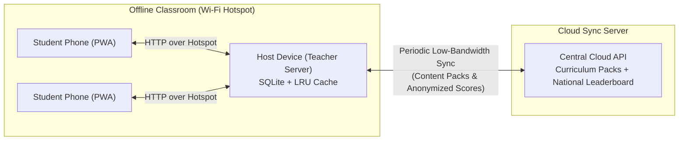

# Implementation Overview

Cort is an offline-first educational platform built around the **"one device downloading, multiple devices accessing"** model, tailored to the Nigerian Basic and Senior Secondary Education curriculum (NERDC / BECE / WAEC / JAMB).

## Major Components

### 1. Unified Rust Backend (`backend/`)
The backend is implemented in Rust using **Axum** and **SQLite (`sqlx`)** as a single unified binary (`cort-backend`). It exposes both:
- **Local Host Server (`/api/host/*`)**: Runs on the teacher's or community facilitator's device over a local Wi-Fi Hotspot. Serves curriculum modules, lessons, and quizzes to student browsers offline, manages lightweight student profiles (Nickname + optional 4-digit PIN), awards points/streaks/badges, maintains the real-time classroom leaderboard, and enforces an LRU storage budget for downloaded content packs.
- **Cloud Sync Server (`/api/cloud/*`)**: Hosts official NERDC-aligned curriculum content packs (seeded with JSS1 Mathematics and JSS1 Basic Science), accepts anonymized score and school leaderboard sync payloads from Host Devices, and serves state and national school leaderboards.

Running both modes in a single binary allows seamless hackathon demonstrations (where the Host Server can sync directly with the local or remote Cloud Server endpoint) while remaining lightweight enough to embed or deploy independently.

### 2. Curriculum & Content Packs
Content is structured into self-contained **Content Packs** mapped to the NERDC curriculum:
- **Subject & Level** (e.g., `JSS1 Mathematics`, `JSS1 Basic Science`)
- **Modules / Topics** (aligned to term schemes of work)
- **Lessons** (text, low-bandwidth audio references, key summaries, and point values)
- **Quizzes & Questions** (multiple-choice questions with explanations and difficulty levels)

### 3. Gamification & Leaderboards
- **Points**: Awarded for completing reading modules (+10 pts) and quiz questions (+15 pts per correct answer, +25 bonus for a perfect score).
- **Streaks & Badges**: Daily learning streaks and milestone badges (`First Steps`, `3-Day Streak`, `Quiz Ace`, `Module Master`).
- **Dual Leaderboards**:
  - **Local Classroom Leaderboard**: Real-time ranking of students connected to the Host Device.
  - **National & State Leaderboard**: Aggregated school and anonymized student rankings updated whenever the Host Device syncs with the Cloud Server.

### 4. Technical Pillars for Low-Resource Environments
- **LRU Storage Management**: The Host Device tracks `size_bytes` and `last_accessed_at` on every cached content pack. When downloading a new pack would exceed the configured storage quota, the least-recently-used unpinned packs are automatically evicted.
- **Privacy & Anonymization**: Student names and PINs stay strictly on the local Host Device. During Cloud Sync, student IDs are hashed with a school-specific cryptographic salt (`SHA-256`) so only anonymized identifiers and aggregated school points are transmitted to the Cloud Server.
- **Low-Bandwidth Sync**: Sync payloads exchange compact JSON deltas and support gzip compression so teachers can sync over slow 2G/3G connections.
